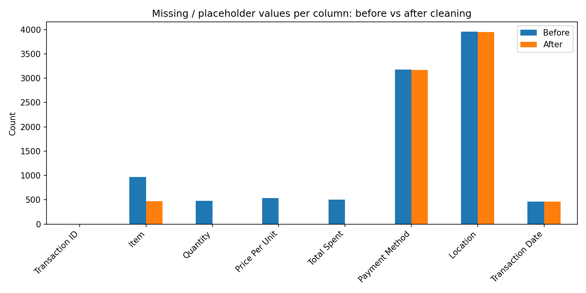

# Data Cleaning: Dirty Cafe Sales

**Oasis Infobyte (OIBSIP) | Data Analytics | Level 1, Task 3**

## Objective
Take a deliberately messy café sales dataset and turn it into a clean, analysis-ready dataset using Python and pandas, documenting every decision along the way.

## Dataset
- **Source:** [Cafe Sales - Dirty Data for Cleaning Training (Kaggle)](https://www.kaggle.com/datasets/ahmedmohamed2003/cafe-sales-dirty-data-for-cleaning-training)
- **Size:** 10,000 rows x 8 columns (Transaction ID, Item, Quantity, Price Per Unit, Total Spent, Payment Method, Location, Transaction Date)

## Problems found
- All columns were stored as text (`object`).
- Hidden missing values ("ERROR", "UNKNOWN") mixed with real nulls: 10,082 missing values in total.
- Worst columns: Location (~40% missing), Payment Method (~32%), Item (~10%).
- No duplicate rows or duplicate Transaction IDs.

## Approach
1. **Data quality report:** nulls, duplicates, data types, and hidden placeholders.
2. **Missing values:**
   - Replaced "ERROR" / "UNKNOWN" with NaN so all missing values were treated the same way.
   - Recovered missing Price Per Unit using the fixed price of each item.
   - Recovered missing Quantity, Price Per Unit or Total Spent using Total Spent = Quantity x Price Per Unit.
   - Recovered 489 missing Items where the price uniquely identifies the item.
   - Dropped only 26 rows (0.26%) that could not be recovered.
   - Labelled the remaining missing Item, Payment Method and Location values as "Unknown" (imputing with the mode would bias 30-40% of those columns).
3. **Duplicates:** checked rows and Transaction IDs; none found.
4. **Standardisation:** stripped whitespace, consistent title case, validated ID and date formats.
5. **Data types:** dates to datetime, Quantity to integer, categorical columns to category.
6. **Outliers:** IQR method and box plots. 268 high Total Spent values were all valid 5-salad orders (25.0), so they were retained.
7. **Validation:** Total Spent equals Quantity x Price Per Unit in every row.

## Results
| Metric | Before | After |
|---|---|---|
| Rows | 10,000 | 9,974 |
| Missing / placeholder values | 10,082 | 8,054 |
| Duplicate rows | 0 | 0 |
| Columns with correct data type (of 8) | 4 | 8 |

Quantity, Price Per Unit and Total Spent now have zero missing values.

## Key learnings
- Hidden placeholders like "ERROR" and "UNKNOWN" are not detected as nulls by pandas and must be handled explicitly.
- Business logic (fixed prices, Total = Quantity x Price) can recover data that would otherwise be dropped.
- Statistical outliers are not always errors; check whether they are valid before removing them.

## Files
| File | Description |
|---|---|
| `data_cleaning.ipynb` | Full notebook with code and written decisions |
| `dirty_cafe_sales.csv` | Raw dataset |
| `cleaned_cafe_sales.csv` | Cleaned dataset |
| `before_after_missing.png` | Before vs after comparison chart |

## Tools
Python, pandas, NumPy, Matplotlib, Seaborn, Google Colab
